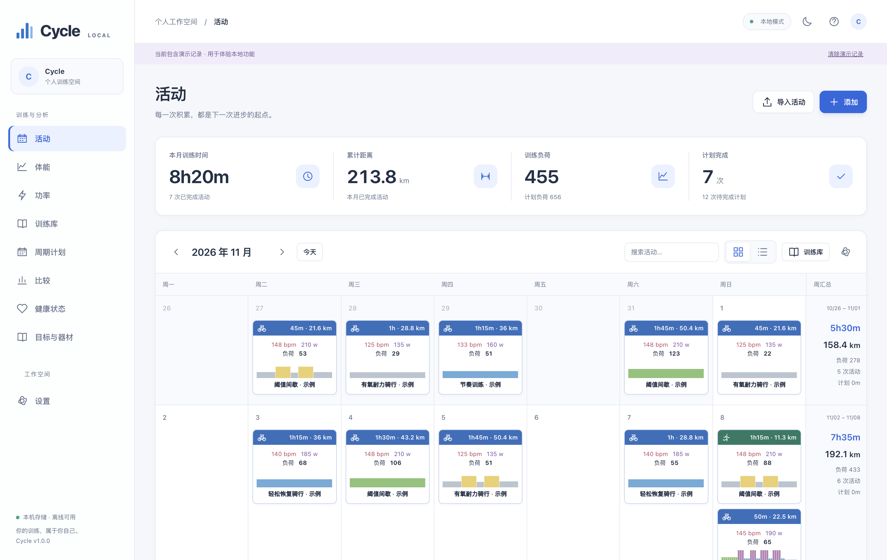
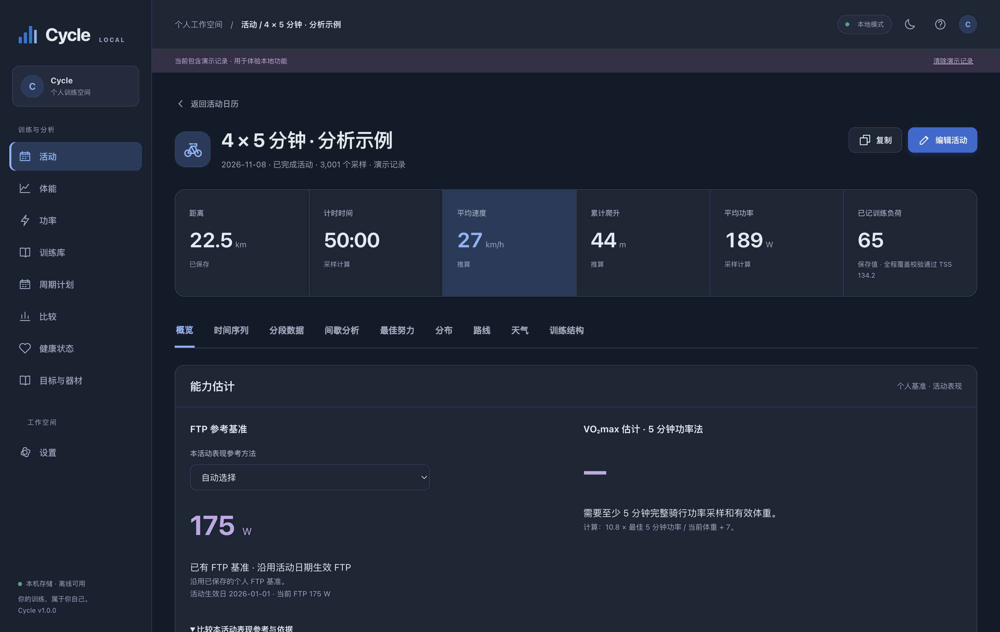

<div align="center">

# Cycle

### 你的训练，属于你自己。

本地训练日志与分析应用，让活动、计划、表现和健康趋势在同一个工作空间连接起来。


[下载正式版](https://github.com/YM200012/Cycle/releases/latest) · [发布说明](docs/RELEASE-v1.0.0.md) · [功能路线图](docs/ROADMAP.md)

</div>



## 从记录到下一次训练

Cycle 围绕骑行训练构建完整的日常工作流：导入码表或骑行台文件，查看曲线与路线，分析训练负荷，安排下一阶段计划，再结合健康指标观察长期变化。

数据保存在本机，训练分析可离线使用。浅色与深色界面采用统一布局，支持日历、图表缩放和活动之间的比较。

| 模块 | 功能 |
| --- | --- |
| 活动日历 | 导入 FIT、CSV、GPX、TCX；管理已完成活动与训练安排 |
| 活动分析 | 速度、功率、心率、踏频、海拔曲线；拖选放大、动态采样、分段与最佳努力 |
| 路线与天气 | 速度渐变轨迹、地图缓存、地形海拔校正、沿程气温与风况分析 |
| 能力与负荷 | NP、IF、TSS、功率区间、FTP 估计、VO₂max 估计与负荷趋势 |
| 训练计划 | 结构化训练编辑、实时预览、ZWO 导出、多周计划及实际活动关联 |
| 健康趋势 | Apple 健康 ZIP/XML 导入；类型与日期筛选、分类图表、月度更新 |
| 目标与器材 | 比赛目标、器材使用里程、维护间隔与维护记录 |
| 数据管理 | SQLite 本机存储、完整 JSON 备份恢复、活动 CSV 导出 |



## 下载与安装

当前正式版本为 **v1.0.0**，提供 **macOS Apple Silicon（M 系列芯片）** 应用包。

1. 下载 [Cycle-1.0.0-macOS-arm64.zip](https://github.com/YM200012/Cycle/releases/download/v1.0.0/Cycle-1.0.0-macOS-arm64.zip)。
2. 解压，将 `Cycle.app` 拖入“应用程序”。
3. 启动 Cycle，导入一次活动，或载入示例体验工作空间。

首次启动如被 macOS 拦截，可在“系统设置 → 隐私与安全性”中核对应用后选择“仍要打开”。发布页提供 `SHA256SUMS.txt`，可用于核对下载文件。

已有版本直接替换应用即可，训练记录、健康数据、计划与设置沿用原有本机数据目录。

## 开始使用

### 导入与分析活动

点击“导入活动”，选择码表、骑行台或训练平台导出的 FIT、CSV、GPX、TCX 文件。进入活动详情后，可在概览、时间序列、分段、间歇分析、最佳努力、路线和天气之间切换。

曲线支持拖选放大；放大后自动增加展示细节。FTP、VO₂max 等结果标明估计方法，已有 FTP 基准与本次活动表现分别呈现。

### 组织训练计划

在训练库编写结构化训练，例如：

```text
10m @ 50-75% | 热身
4x {
  4m @ 100% | 阈值
  90s @ 55% | 恢复
}
5m @ 50% | 放松
```

预览训练结构并保存，随后安排到日历，或组合成多周周期计划。完成训练后可关联实际活动，跟踪执行进度。

### 导入 Apple 健康

1. 在 iPhone“健康”中点击头像，选择“导出所有健康数据”。
2. 在 Cycle“健康状态”中上传完整 ZIP 或解压后的 XML。
3. 查看数据类型清单，选择指标和时间段。
4. 预览图表，确认保存。

支持导出文件中各类健康 Record 的类型目录、数值指标、累计量、睡眠阶段及其他分类状态；常见指标采用专用聚合规则，未识别类型采用通用数值或分类汇总。各类型按自身单位和聚合方式绘图，支持搜索、展开和收起。Apple 健康导入范围为健康指标，Workout 运动记录保持独立。

按月重新导入完整导出，可以补充新日期、更新苹果来源汇总并保留手动值。临时 ZIP/XML 在保存、取消、解析失败或超时后清理，长期保存的是选中数据的日汇总与来源。

## 本机数据与联网功能

活动、健康指标、训练计划和设置均保存在设备上的 SQLite 数据库。可随时通过“设置 → 导出完整备份”保存 JSON，并在另一份 Cycle 中恢复。

macOS 桌面版的数据目录为 `~/Library/Application Support/Cycle/data/`。替换应用包会保留该目录；迁移设备时使用 JSON 备份与恢复。

地图底图、地形高程与沿程天气按需联网获取，缓存后可复用。导入、训练分析与已有记录浏览在本机完成。

## 本地开发

环境要求：**Node.js 22.16+**。

```sh
git clone https://github.com/YM200012/Cycle.git
cd Cycle
npm ci
npm start
```

也可以启动本地网页版：

```sh
npm run web
```

随后访问 `http://127.0.0.1:3210`。网页版默认数据目录为项目内 `data/`，与桌面版独立；可通过 `CYCLE_DATA_DIR` 和 `CYCLE_PORT` 指定数据目录与端口。

运行测试和构建桌面应用：

```sh
npm test
npm run package
```

`npm run package` 为当前系统和架构构建 Electron 应用，输出至 `release/v<版本号>/`。

```text
src/         应用界面、本地服务、文件解析与训练分析
electron/    Electron 桌面入口
tests/       解析、计算、接口与视图测试
scripts/     开发启动与桌面打包
docs/        使用说明、计算口径与版本记录
```

## 文档

- [1.0.0 发布说明](docs/RELEASE-v1.0.0.md)
- [健康指标与聚合口径](docs/WELLNESS.md)
- [FTP 与能力估计](docs/INFERENCE.md)
- [开发路线图](docs/ROADMAP.md)
- [第三方组件说明](THIRD_PARTY_NOTICES.txt)

欢迎通过 [Issues](https://github.com/YM200012/Cycle/issues) 反馈问题与功能建议。
